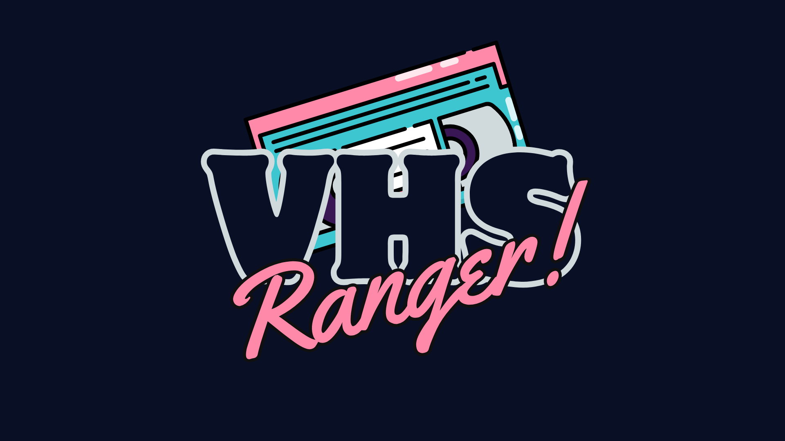
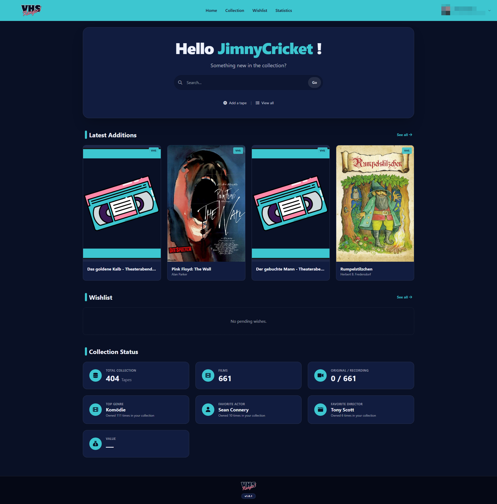
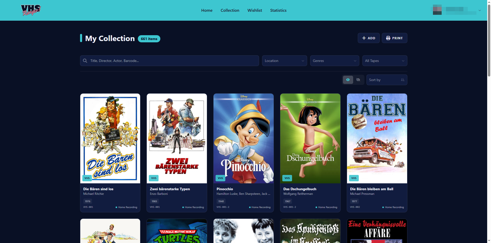
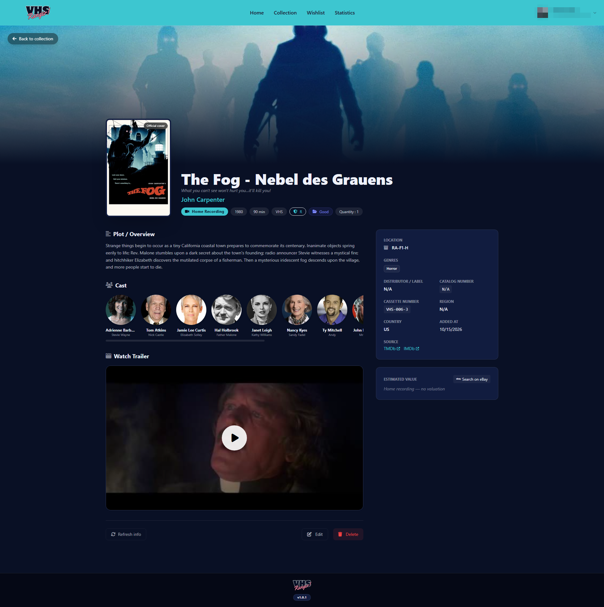
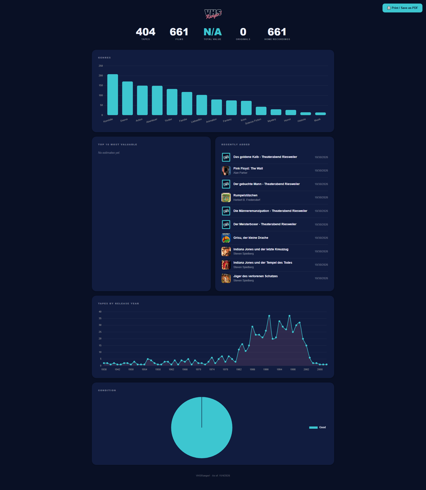

<div align="center">



<br/><br/>

# VHSRanger!

### A self-hosted collection manager for VHS tape enthusiasts

Catalog your tapes with metadata from TMDb, keep track of where each one lives,
and see what your collection is made of. Your data stays on your own server.

<p>
  
  
  
  
</p>

**[Overview](#-overview)** ·
**[Features](#-features)** ·
**[Screenshots](#-screenshots)** ·
**[Getting Started](#-getting-started)** ·
**[Unraid](#-unraid)** ·
**[Configuration](#-configuration)** ·
**[Roadmap](#-roadmap)**

</div>

<br/><br/>

##  Overview

**VHSRanger!** keeps track of your VHS tape collection. It uses the TMDb API to fetch metadata, covers
and cast information, and presents everything in a customizable dashboard on your home server.

Each tape can be flagged as an **original** retail release or a **home recording**, and only originals
carry a value estimate. Several films can share one cassette number, so the statistics can tell films
apart from physical tapes.

<br/><br/>

##  Features

- **Smart import** – Add tapes by searching TMDb, pasting a TMDb or IMDb link, scanning a barcode, or entering them manually.
- **Duplicate detection** – Flags matching entries when you add a tape you may already own, so you can bump the quantity instead.
- **Cassette numbers** – Number your physical tapes, record several films on one cassette, and get a warning when a number is already taken.
- **Original or home recording** – Every tape is flagged as a retail release or a self-recorded copy. Value estimates only apply to originals.
- **Price estimates** – Enter a value yourself or get a rough estimate from active eBay listings (optional, requires eBay API keys).
- **Organization** – Track the shelf location and condition of every tape, then search, filter and sort by them.
- **Statistics** – A statistics page with genres, conditions, release years and your most valuable tapes, plus modular dashboard widgets.
- **Wishlist** – Keep track of future finds and move them into your collection once you have them.
- **Print and PDF** – Export your collection or wishlist as a printable list.
- **User accounts** – Create read-only accounts for other people, and hide specific tapes, genres or types from them.
- **Backups** – Manual and scheduled backups with adjustable retention, plus restore. A restore checks the file first, saves the current state and rolls back if it fails.
- **Color themes** – 8 built-in themes, each with a light and a dark mode.
- **Five languages** – English, German, French, Spanish and Italian, switchable per account.

<br/><br/>

##  Screenshots

<div align="center">

| Dashboard | Collection |
| :---: | :---: |
|  |  |

| Details | Statistics |
| :---: | :---: |
|  |  |

</div>

<br/><br/>

##  Tech Stack

| **Area** | **Technology** | **Purpose** |
| :--- | :--- | :--- |
| **Backend** |  | Express with JWT login and bcrypt password hashes |
| **Frontend** |  | EJS templates, Tailwind CSS and plain JavaScript |
| **Database** |  | MongoDB, accessed through Mongoose |
| **Localization** | i18next | Translations for five languages |
| **External APIs** | TMDb, eBay Browse API | Film metadata and optional price estimates |
| **Container** |  | Image published to GHCR via GitHub Actions |

<br/><br/>

##  Getting Started

### Prerequisites

- Docker with Compose

### Installation

```bash
git clone https://github.com/xXJimnyCricketXx/VHSRanger.git
cd VHSRanger
cp .env.example .env
# edit .env and set at least PASSJWT, e.g. to the output of: openssl rand -hex 32
docker compose up -d --build
```

The app is now available at:

```text
http://localhost:18003
```

On the first visit, create your admin account on the setup page.

### Further guides

- [Docker deployment](docs/docker.md) – Pre-built image, troubleshooting and updates
- [Manual setup](docs/getting-started.md) – Running the app with Node.js and your own MongoDB
- [API configuration](docs/api-keys.md) – Getting your TMDb key

<br/><br/>

##  Unraid

The image is built by GitHub Actions on every push to `main` and on `v*` tags
([docker-publish.yml](.github/workflows/docker-publish.yml)):

```text
ghcr.io/xxjimnycricketxx/vhsranger:latest
```

**1. Install MongoDB.** Any MongoDB template works. Note its IP or hostname.

**2. Install the template.** On the Unraid console:

```bash
curl -fsSL -o /boot/config/plugins/dockerMan/templates-user/my-VHSRanger.xml https://raw.githubusercontent.com/xXJimnyCricketXx/VHSRanger/main/unraid-template/vhsranger.xml
```

**3. Create the container.** Go to *Docker → Add Container → Template: VHSRanger*.

Port `18003`, the appdata paths under `/mnt/user/appdata/vhsranger` and `PUID`/`PGID` are pre-filled. Set `MongoDB URL` and `JWT Password`, and optionally your TMDb key.

**Updates:** *Docker → Check for Updates*, then apply the update for VHSRanger.

**Installed before 1.1.0?** An older install may have left a second template named `vhsranger.xml`. Unraid can then rebuild the container from that file on updates and drop variables added later. Move it out of the way once:

```bash
mv /boot/config/plugins/dockerMan/templates-user/vhsranger.xml /boot/config/plugins/dockerMan/vhsranger.xml.bak
```

Then add `PUID=99` and `PGID=100` to your container, remove `SESSION_SECRET`, and make sure `JWT Password` is your own random value.

<br/><br/>

##  Configuration

All settings are environment variables: `.env` for Docker Compose, template variables on Unraid.

| Variable | Required | Default | Description |
| --- | :---: | --- | --- |
| `MONGODB_URL` | ✅ | – | Connection string for your MongoDB instance. The Compose setup uses `mongodb://mongodb:27017/vhsranger` |
| `PASSJWT` | ✅ | – | Long random secret that signs login tokens. The app refuses to start with an example value |
| `PUID` / `PGID` | ❌ | Owner of the backups folder, or `1000` if that is root | User and group the container runs as and that own the uploads and backups folders. The Unraid template uses `99` / `100` |
| `TZ` | ❌ | `UTC` | Time zone for scheduled backups, e.g. `Europe/Berlin`. Unraid sets it for you |
| `PROD` | ❌ | `false` | Set to `true` **only** when serving over HTTPS through a reverse proxy, otherwise login cookies stop working. Without it, the app sees the proxy's IP for every visitor, so login limits and IP blocks apply to all of them together |
| `VHS_PORT` | ❌ | `3098` | Port the app listens on inside the container |
| `BASE_URL` | ❌ | empty | Base path for serving on a sub-path, leave empty to serve from root |
| `TMDB_API_KEY` | ❌ | empty | TMDb **API Read Access Token**. The app works without it, but metadata lookup does not |
| `EBAY_APP_ID` / `EBAY_CERT_ID` | ❌ | empty | eBay Browse API production keys from [developer.ebay.com](https://developer.ebay.com). Enable the price estimate button on the detail page |

> [!IMPORTANT]
> Backups are stored in the `backups` folder on the same disk as the app and contain your account data,
> including password hashes. Copy them to another disk and keep them private.

> [!WARNING]
> Without a login on MongoDB, anyone who can reach its port can read the database, including password
> hashes. Keep the port private or [secure it](docs/docker.md#-database-access).

> [!WARNING]
> The app itself speaks plain HTTP. Keep it inside your home network, and use a VPN or an HTTPS reverse
> proxy for access from outside.

<br/><br/>

##  Project Structure

```text
VHSRanger/
├── config/              # database connection, constants, built-in themes
├── controllers/         # login and logout handlers
├── routes/              # Express routes
├── middleware/          # login protection and settings
├── models/              # Mongoose schemas
├── utils/               # backups, migrations, visibility and currency helpers
├── views/               # EJS templates
├── locales/             # translations
├── public/              # logos, icons, stylesheet and frontend libraries
├── public-tpl/          # web app manifest and service worker templates
├── assets/              # source of the Tailwind build
├── tests/               # end-to-end tests
├── docs/                # guides and images
├── unraid-template/
├── .github/workflows/
│   └── docker-publish.yml
├── app.js
├── changelog.json       # shown in the settings
├── docker-entrypoint.sh # hands the folders to PUID:PGID, then drops root
├── Dockerfile
├── docker-compose.yml
└── .env.example
```

<br/><br/>

##  Roadmap

| **Version** | **Features** | **Status** |
| :---: | :--- | :---: |
| **1.1.0** | <ul><li>Runs on Node.js 24 without root rights, with `PUID` and `PGID`</li><li>Refuses to start with an example login secret, and `SESSION_SECRET` is gone</li><li>Live updates are limited to admins</li><li>Frontend libraries and fonts ship with the app instead of external CDNs</li><li>Automated tests run before every image build</li><li>Major dependency updates, no known vulnerabilities</li><li>Scheduled backups follow the `TZ` time zone</li><li>Print view, statistics and web app use the active theme colors</li><li>The dashboard always shows current data, and logging out always leads to the login page</li><li>Changelog in the settings</li><li>Unraid: no second template that can drop variables on updates</li></ul> |  |
| **1.0.1** | <ul><li>Login right after first-run setup works</li><li>Admin actions show a clear success or error message, and a duplicate user is reported as an error</li><li>"Delete last items" works again</li><li>Natural sorting of titles and cassette numbers</li><li>Totals convert between currencies</li><li>All pages, dialogs and print views follow your language, dates and numbers too</li><li>English is the default language for new users</li><li>The app starts and recovers on its own when the database is unavailable</li><li>Scheduled backups catch up after downtime</li><li>Unusual links no longer cause server errors, and the web app installs correctly</li></ul> |  |
| **1.0.0** | <ul><li>First tagged release with versioned Docker images</li><li>First-run setup is locked once an admin exists</li><li>Login throttling per client, and old sessions end when the password changes</li><li>Avatar uploads only accept real image files</li><li>Hidden tapes, genres and types stay hidden on every page</li><li>Editing a tape keeps its cast, and a second copy never overwrites the first</li><li>Backup restore validates the file first, keeps a safety copy and rolls back on failure</li><li>Updated dependencies</li></ul> |  |

See the [open issues](../../issues) for planned features and known problems.

<br/><br/>

##  Development

Run the app locally against your own MongoDB. Set `MONGODB_URL` in `.env` to point at it first:

```bash
npm install
cp .env.example .env
npm run dev
```

The app is then available at `http://localhost:3098`.

The tests need a MongoDB as well and wipe a database named `vhsranger_test`:

```bash
TEST_MONGODB_URL=mongodb://127.0.0.1:27017/vhsranger_test npm test
```

After changing Tailwind classes in the views, rebuild the stylesheet with `npm run build:css`.

<br/><br/>

##  Contributing

Issues and pull requests are welcome. Please open an issue first for larger changes.

<br/><br/>

##  License

This project is licensed under the **MIT License**.

See [`LICENSE`](LICENSE) for details.

<br/><br/>

---

<br>

<div align="center">

<a href="https://github.com/xXJimnyCricketXx">
  
</a>
<a href="https://cricketcode.de">
  
</a>

</div>
